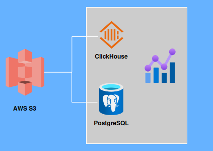
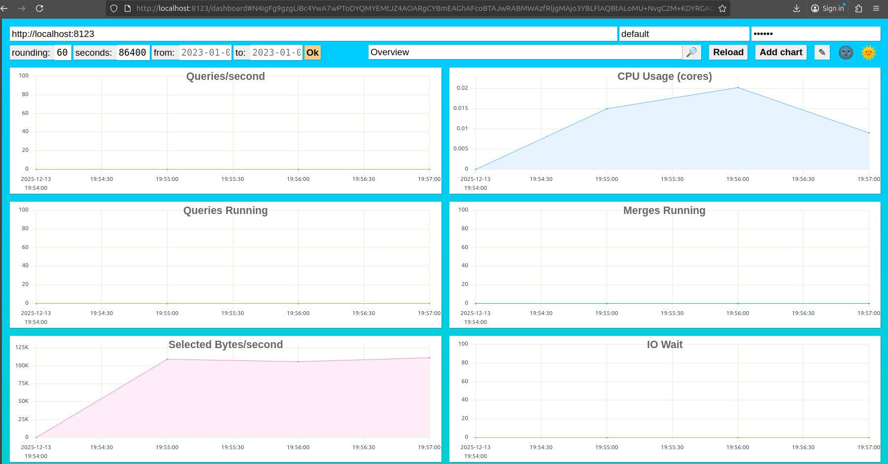
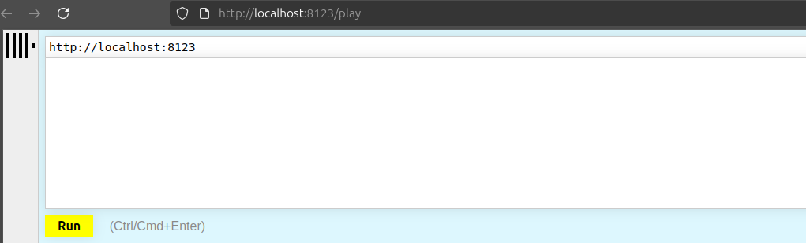
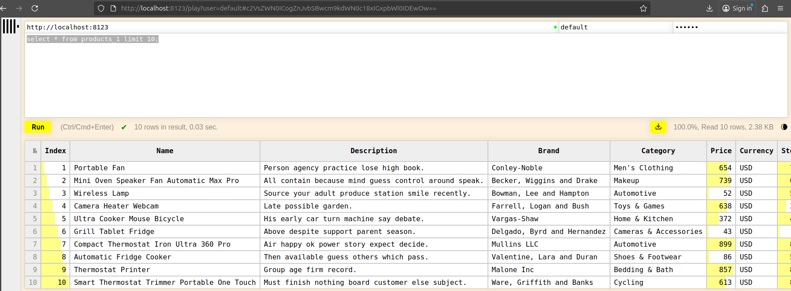
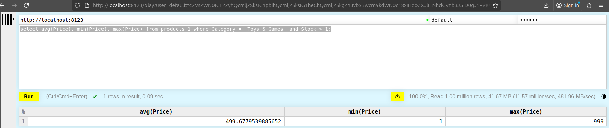
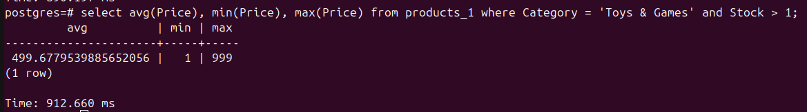

# Setup ClickHouse and Compare to PostgreSQL



## Install ClickHouse
* `docker pull clickhouse/clickhouse-server`
* `docker run -d -p 8123:8123 -p 9000:9000 --name adi-clickhouse-server --cpus="1" --memory="2048m" --ulimit nofile=262144:262144 -e CLICKHOUSE_PASSWORD=adi123 clickhouse/clickhouse-server`

http://localhost:8123/dashboard


http://localhost:8123/play


* `docker exec -it adi-clickhouse-server clickhouse-client`
* `CREATE TABLE products_1 ENGINE = MergeTree ORDER BY tuple() AS SELECT * FROM url('https://adi-clickhouse.s3.ap-southeast-1.amazonaws.com/products-1000000.csv', 'CSVWithNames');`

* `select avg(Price), min(Price), max(Price) from products_1 where Category = 'Toys & Games' and Stock > 1;`

## Install PostgreSQL
* `docker run --name adi-postgres --cpus="1" --memory="2048m" -e POSTGRES_PASSWORD=adi123 -d -p 5432:5432 postgres`
* `docker exec -it adi-postgres /bin/sh`
* `curl -O https://adi-clickhouse.s3.ap-southeast-1.amazonaws.com/products-1000000.csv`
* `psql -U postgres`
```
CREATE TABLE products_1 (
    Index BIGINT NULL,
    Name VARCHAR NULL,
    Description VARCHAR NULL,
    Brand VARCHAR NULL,
    Category VARCHAR NULL,
    Price BIGINT NULL,
    Currency VARCHAR NULL,
    Stock BIGINT NULL,
    EAN BIGINT NULL,
    Color VARCHAR NULL,
    Size VARCHAR NULL,
    Availability VARCHAR NULL,
    Internal_ID BIGINT NULL
);
```
* `COPY products_1 FROM '/products-1000000.csv' WITH CSV HEADER;`
* `select avg(Price), min(Price), max(Price) from products_1 where Category = 'Toys & Games' and Stock > 1;`

## Compare Query Time
###Data

###ClickHouse

###PostgreSQL
